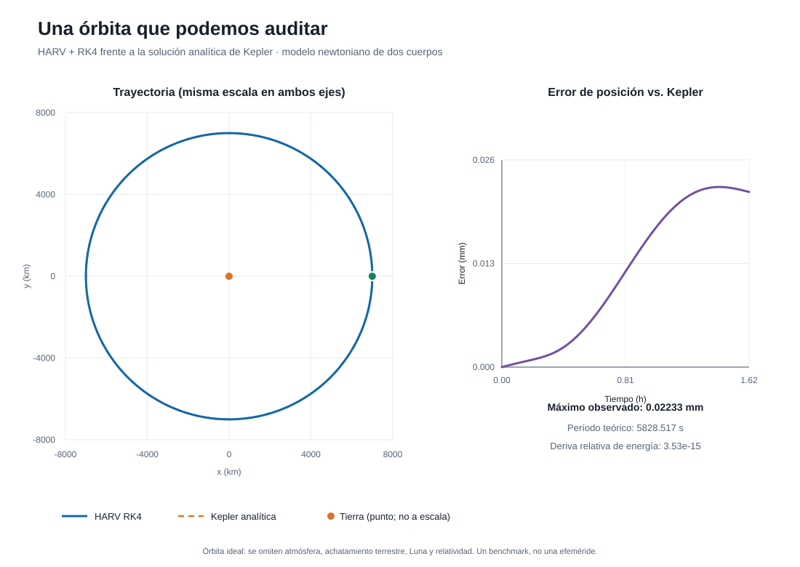
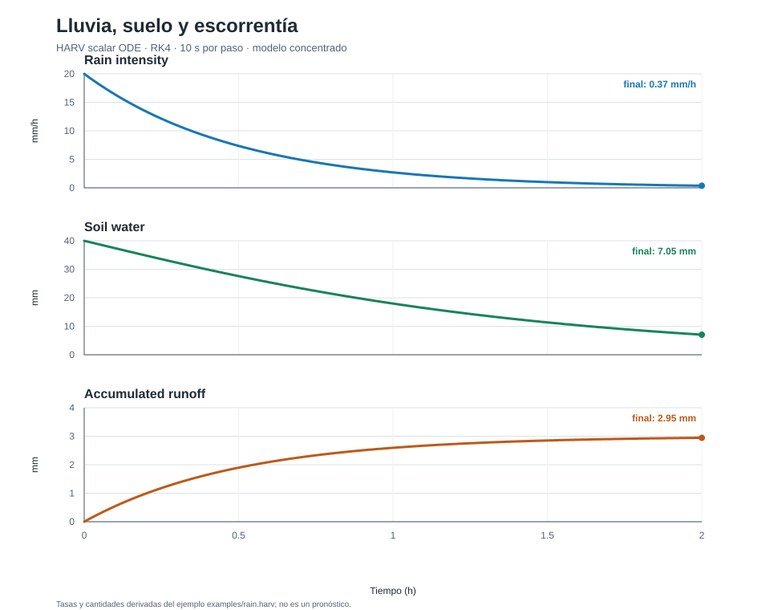

# HARV

## The Physics Programming Language — experimental

**Vision:** make mathematical models directly executable. Unity renders triangles; HARV aims to make equations executable.

**Verified milestone — 11 October 2026:** the Python v0.1 prototype parses scalar ODE models, checks units, lowers them to typed IR, runs Euler/RK4, and aborts when an explicit scalar comparison constraint fails. `pytest` currently reports 39 passing tests, including rainfall and 2D/3D Kepler-orbit regression checks, a second orbital radius, and RK4 step refinement.

**Not implemented yet:** Rust compilation, vector or field state, Navier–Stokes/PDE execution, AI learning operators such as `backward()`, GPU acceleration, 512×512 ocean performance, 50 FPS, and a hosted `harv.cloud` service. Those are goals, not measured results or current capabilities.

This repository contains a runnable **v0.1 scalar ODE MVP**, implemented as a Python prototype. Python is the current host for the prototype; it is not the conceptual definition of the language. Rust remains the preferred future compiler implementation.

## v0.1 includes

- A handwritten lexer with token kind, value, line and column.
- A Pratt expression parser and an explicit AST.
- Semantic checks for declarations, names, solver configuration and dimensional units, including `USD`, `year`, `Pa`, and `J`.
- An immutable typed scalar IR that normalizes units and initial values before numerical execution.
- Executable scalar comparison constraints, checked at the initial state, RK/Euler stages, and after each step; violations abort with source line and simulation time.
- Scalar state and pure ODE operators.
- Deterministic Euler and classical RK4 solvers.
- `t`, SI base units `m`, `s`, `kg`, `K`, `A`, and compound units such as `m/s^2` and `1/s`; `rad` is dimensionless and `deg` converts to radians.
- `harvc check`, `harvc ast`, and `harvc run`; optional CSV time-series output.
- Decay, logistic growth, forced oscillator, pendulum, SIR, lumped rainfall/infiltration/runoff, and two-body orbit examples.

## Requirements and installation

Python 3.10 or later is required. From this directory:

```powershell
python -m venv .venv
.\.venv\Scripts\Activate.ps1
python -m pip install -e ".[test]"
```

No runtime third-party package is required. `pytest` and `jsonschema` are installed only by the `test` extra.

## Use

```powershell
harv run examples/decay.harv
harv run examples
harvc check examples/decay.harv
harvc ast examples/decay.harv
harvc ir examples/decay.harv
harvc run examples/decay.harv --csv decay.csv
harvc run examples/decay.harv --csv decay.csv --manifest decay-run.json
harvc run examples/sir.harv --csv sir.csv
harvc check-json examples/decay.harv.json
harvc run-json examples/positive_decay.harv.json
harvc ir-json examples/decay.harv.json
harvc run-json examples/decay.harv.json --csv decay-from-agent.csv --manifest agent-run.json
```

`harv` and `harvc` are equivalent command names. The source execution path is
`parse` → semantic and unit validation → typed IR → solver; the Python API for
that path is `harv.pipeline.execute_source` (or `execute_program` for an AST).

Or without installing the command:

```powershell
python -m harv.cli run examples/decay.harv --csv decay.csv
```

Run the tests with:

```powershell
pytest
```

## Language example

```harv
state Decay {
    x: scalar<m>
    k: scalar<1/s>
}

init Decay {
    x = 1.0<m>
    k = 2.0<1/s>
}

operator Physics {
    dx_dt = -k*x
    dk_dt = 0<1/s^2>
}

evolve Decay using Physics {
    dt = 0.01<s>
    duration = 5<s>
    method = RK4
}

observe x
```

The `operator` computes derivatives from the current state and time; the solver owns state updates. `constraint x > 0<m>` declares an executable predicate. Comparisons require dimensionally compatible operands, so a length is compared with `0<m>`, not a unitless zero. If the predicate becomes false at an integration stage, the solver stops and reports the constraint and time; it does not project or repair the state. `observe` controls which state values appear in output (time is always included). Each declared scalar needs one initial value and one derivative. `dt` and `duration` must be positive, use compatible time units, and divide evenly; the runtime normalizes time to seconds.

`examples/sir.harv` is a closed, homogeneously mixed SIR model with fixed rates and population fractions. Its test checks that `S + I + R` remains 1 under RK4. It is a numerical example, not a calibrated epidemiological model or forecast.

`examples/rain.harv` is a lumped scalar ODE: rain intensity fades exponentially, a fixed fraction infiltrates, soil water drains linearly, and the remainder accumulates as runoff. Its dimensional constraints and RK4 trajectory run on the existing scalar solver. It has no spatial grid, terrain, clouds, or fluid dynamics, so it is a teaching model rather than a weather forecast.

`examples/orbit.harv` is an ideal circular Earth orbit under Newtonian point-mass gravity. It exercises dimensional square roots and fractional powers in the force law. Check its RK4 trajectory against the analytic Kepler orbit, including energy, angular momentum, and radius drift:

```powershell
harv run examples/orbit.harv --csv outputs/orbit_trajectory.csv
python scripts/analyze_orbit.py
python scripts/plot_orbit.py
```

With the included 2 s step, the analytic period is 5828.5166 s. Over 2914 steps, the checker reports a final position error of `3.10e-12` times the orbital radius and maximum relative specific-energy drift of `3.66e-15` (Python `float64`; this is a numerical benchmark, not a universal accuracy guarantee).



This reproduces a known orbital result; it is a numerical validation example, not a new space discovery or an operational trajectory. Atmospheric drag, Earth's oblateness, other bodies, and relativity are omitted.

`examples/orbit_3d.harv` extends the same point-mass ODE to scalar `x`, `y`, and `z` coordinates, with the orbital plane tilted 45 degrees. It checks the full 3D position and velocity against the analytic circular solution at every sample and tracks energy, angular-momentum magnitude, and radius drift:

```powershell
harv run examples/orbit_3d.harv --csv outputs/orbit_3d_trajectory.csv
python scripts/analyze_orbit_3d.py
```

This is a three-coordinate ODE example, not general vector/tensor support, a 3D scene renderer, or a spatial field solver. It validates the existing scalar runtime on an inclined orbit; it does not discover a new orbit or model real-world perturbations.

The regression suite also repeats the 3D trajectory at 8 s, 4 s, and 2 s steps over a shared duration. While truncation error dominates, halving RK4's step should reduce global error by about a factor of 16; a second-radius case checks that the result is not tied to one initial orbit.



Reproduce its time series and figure without plotting dependencies:

```powershell
harv run examples/rain.harv --csv outputs/rain_trajectory.csv
python scripts/plot_rain.py
```

The plot converts the solver's SI output to hours, millimetres, and millimetres per hour, and writes the figure shown above.

## Project layout

- `harv/lexer.py`: tokenization and source positions.
- `harv/ast.py`: syntax tree data types.
- `harv/parser.py`: block grammar and Pratt expression parser.
- `harv/units.py`: SI dimension algebra.
- `harv/semantic.py`: name/type/unit checks and expression evaluation.
- `harv/ir.py`: lowers validated ASTs into immutable typed expressions, SI initial values, and a time grid.
- `schemas/harv-typed-ir-0.1.schema.json`: versioned JSON contract for exported typed IR.
- `examples/decay.typed-ir.json`: generated typed-IR reference for the decay model.
- `harv/solver.py`: Euler/RK4 execution over typed IR; `run()` remains a source-AST convenience wrapper.
- `harv/cli.py`: command line entry point.
- `harvc/`: dependency-free Rust crate containing the compiler-facing AST types; lexer/parser are not implemented in Rust yet.
- `tests/`: lexer, parser, units, semantic, solver and reproducibility tests.
- `examples/`: runnable scalar ODE programs, including SIR.
- `docs/GRAMMAR_AND_AST.md`: formal EBNF, typed AST schema and lowering contract.
- `docs/HARV_PLUS_LANGUAGE_DESIGN.md`: proposed HARV+ semantics, model boundaries and staged roadmap.
- `docs/AI_MODEL_PROTOCOL.md` and `schemas/harv-model-0.1.schema.json`: versioned machine exchange format for AI-proposed scalar ODE models and comparison constraints, supported by `check-json` and `run-json`.
- `schemas/harv-run-record-0.1.schema.json`: schema for optional execution provenance manifests.
- `harv/machine.py`: validates and lowers the supported machine-model JSON subset to the scalar source AST; shared typed lowering produces the runtime IR.
- `examples/decay.harv.json`: machine-format exponential decay example.
- `examples/positive_decay.harv.json`: machine-format decay with a checked dimensional constraint.
- `examples/pendulum.harv`: second-order pendulum written explicitly as first-order angle/angular-velocity dynamics with both initial conditions.

## Deliberate v0.1 limits

Only first-order scalar ODE systems run today. Second-order equations such as a pendulum must be written with explicit angle and angular-velocity states plus initial values for both; see `examples/pendulum.harv`. `USD` is a bookkeeping dimension for model consistency, not an economic theory or guarantee. `year` converts to a Julian year in the solver's SI-second internal time base. Vectorized entity states, `field2d`, indexing, `zeros`, `laplacian`, `gradient`, `divergence`, implicit methods, GPU and visualization are not implemented. Constraints currently support scalar comparisons with dimensional checks and abort-on-violation only; they do not project or repair the state. Non-scalar state types and vector/field functions receive explicit errors.

## Roadmap

1. Keep the scalar frontend, dimensional analysis and solvers correct.
2. Design typed IR and a backend abstraction.
3. Add vector states and then fields with verified discrete operators.
4. Build the water-wave PDE example on those field primitives.
5. Separate visualization from the solver and assess a Rust compiler implementation.
